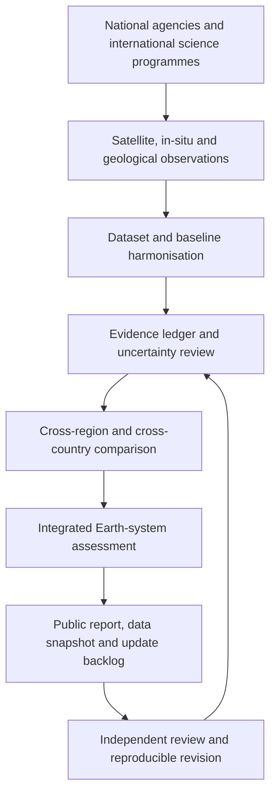

# Global Earth System Review
## A reproducible, multi-source assessment of the atmosphere, cryosphere, oceans and solid Earth

**Snapshot date:** 3 November 2026  
**Coverage:** Global  
**Project status:** Public research baseline; not a live operational monitoring service  
**Language:** English

This research collection brings climate science, satellite Earth observation, oceanography, geology, geophysics, volcanology, seismology and paleoscience into one evidence-led assessment. Its purpose is to give the public a clear global synthesis and give future researchers a documented starting point that can be updated without repeating the initial source search.

The structure follows the evidence-first style of the repository's existing F-15 geolocation assessment, but the subject here is the Earth system as a whole. It does not reuse that report's location estimates or claim that every source on Earth has been exhaustively searched.

## Main findings

1. **The measured Earth system is accumulating heat.** WMO reports that 2015–2025 were the eleven warmest years in the instrumental record and that the planetary energy imbalance reached the highest value in its 65-year record. The 2025 global mean temperature was about 1.43 ± 0.13 °C above 1850–1900, ranked second or third depending on the dataset.
2. **Greenhouse-gas concentrations reached new highs.** WMO's 27 October 2026 bulletin reports 2025 global means of 426.8 ± 0.2 ppm CO₂, 1,948 ± 2 ppb methane and 339.1 ± 0.1 ppb nitrous oxide.
3. **Fossil-carbon emissions remained near record levels.** Global Carbon Budget estimates 38.1 GtCO₂ from fossil fuels and cement-related processes in 2025, up about 1.0%. IEA estimates 38.4 GtCO₂ of energy-related emissions, up about 0.4%. These are different accounting scopes and must not be averaged.
4. **Ocean heat and sea level continue to rise.** WMO reports record ocean heat content in 2025. NASA's sea-level indicator reported 115.8 ± 4.0 mm above the 1993 reference in October 2026.
5. **Land ice is losing mass, while annual sea-ice values vary by region and method.** WGMS estimates a 408 ± 132 Gt loss from mountain glaciers in hydrological year 2025. NASA GRACE/GRACE-FO estimates average losses of about 264 Gt/year from Greenland and 135 Gt/year from Antarctica over 2002–2025.
6. **The 2026 Antarctic ozone-hole area was unusually large at points in the season, but area alone is not the whole ozone diagnosis.** CAMS reported about 25 million km² on 12 September, while ozone-column minimum and ozone-mass-deficit indicators were near their historical averages at that time.
7. **The solid Earth remains tectonically active, but no evidence here supports a single, synchronous global geophysical crisis.** Earthquakes, volcanic unrest, magnetic-field variation and plate motion are real but must be interpreted using their own baselines and mechanisms.
8. **The ocean floor remains a major observation gap.** GEBCO_2026 reports that 28.7% of the global ocean floor has been mapped to modern standards.

These are findings from different observing systems, periods and baselines. They are not a single unified measurement.

## Research map

| Document | Purpose |
|---|---|
| [Executive assessment](EXECUTIVE-ASSESSMENT.md) | Integrated conclusion and confidence levels |
| [Climate, cryosphere and atmosphere](CLIMATE-CRYOSPHERE-ATMOSPHERE.md) | Temperature, ice, greenhouse gases, energy, ozone and sea level |
| [Solid Earth and tectonics](SOLID-EARTH-INTERIOR-TECTONICS.md) | Crust, mantle, core, geomagnetism and plate motion |
| [Volcanoes and submarine volcanism](VOLCANOES-SUBMARINE-VOLCANISM.md) | Global volcano status, undersea eruptions and monitoring |
| [Global seismology](GLOBAL-SEISMOLOGY.md) | Earthquake catalogs, networks and interpretation |
| [Ocean floor and marine observing](OCEAN-FLOOR-AND-MARINE-OBSERVING.md) | Bathymetry, ocean observatories, sonar and sea-level measurement |
| [Paleo-Earth and deep time](PALEO-EARTH-AND-DEEP-TIME.md) | Ancient climate, fossils, sediments and long-term context |
| [Cross-country source reconciliation](CROSS-COUNTRY-SOURCE-RECONCILIATION.md) | How independent national and international sources agree or differ |
| [Source and data catalog](SOURCE-CATALOG.md) | Curated institutional source directory |
| [Methods and uncertainty](METHODS-UNCERTAINTY-AND-REPRODUCIBILITY.md) | Evidence classes, baselines, uncertainty and reproducible workflow |
| [Roadmap and contribution guide](ROADMAP-AND-CONTRIBUTING.md) | How the public can extend the research |
| [Glossary](GLOSSARY.md) | Technical terms |
| [Indicator snapshot CSV](data/indicator-snapshot.csv) | Machine-readable values and caveats |
| [Source register CSV](data/source-register.csv) | Machine-readable institutional source list |
| [CSV data dictionary](data/README.md) | Column definitions, provenance rules and update instructions |
| [License](LICENSE.txt) | License for project-authored documentation and curated tables |

## Evidence model

Every claim should be assigned one of the following types:

- **OBSERVATION:** A directly measured value or sensor product.
- **ASSESSMENT:** A reviewed synthesis by a scientific agency or research group.
- **ESTIMATE:** A derived quantity with a stated method and uncertainty.
- **FORECAST:** A probabilistic statement about a future period.
- **INTERPRETATION:** An explanation based on several evidence layers.
- **HYPOTHESIS:** A plausible explanation not yet independently established.
- **UNRESOLVED:** Evidence is incomplete, inconsistent or insufficient.

A forecast is never presented as an observation. A satellite pixel is not automatically a ground-truth coordinate. A public alert colour is not comparable across agencies unless the alert systems are explicitly mapped.

## Research workflow

## Important limitations

- This is a **dated research snapshot**, not a continuous live feed.
- No claim is made that every national website, forum, ship, satellite scene or seismic waveform has been exhaustively reviewed.
- Raw Sentinel, GRACE, Swarm, sonar and waveform archives have not all been independently downloaded and reprocessed for this release. Where a published product or agency analysis is used, it is identified as such.
- Global means can conceal substantial regional variation.
- Differences between products can result from sensors, thresholds, gridding, reference periods, averaging windows and quality control.
- No earthquake or volcanic eruption can be predicted precisely from the material in this report.
- Statements about the deep interior rely on seismic, geomagnetic, geodetic and mineral-physics inference; satellites do not photograph the core.

## Data and reuse

The written research notes and the curated CSV tables are released under **CC BY 4.0**, except where a linked source imposes its own terms. Always cite the original dataset or institution when reusing a measurement. Source licensing takes precedence over this project's documentation license.

## How to continue

Start with the [Roadmap and contribution guide](ROADMAP-AND-CONTRIBUTING.md), use the [source register](data/source-register.csv), record the exact dataset version and retrieval date, and submit corrections or updates through the repository's GitHub issue templates.

**Snapshot prepared:** 3 November 2026  
**Repository:** https://github.com/salehshahab999-gif/sentinel-command  
**Project directory:** earth-system-global-review/

## Read the complete report on one page

**[Open the Global Earth System Complete Report](../Global-Earth-System-Complete-Report.md)**. The single document includes the full assessment, all scientific chapters, methods, source catalog, glossary and both complete data tables. The modular files remain available for focused citations and maintenance.

## Visual dashboard and annual comparison

The single-page report now opens with a visual dashboard built from the indicator table:

- [Visual dashboard SVG](assets/earth-system-dashboard.svg)
- [Annual comparison: 2024 versus 2025](../EARTH-SYSTEM-ANNUAL-COMPARISON.md)
- [Annual observation series (CSV)](data/annual-observations.csv)
- [Complete one-page report](../Global-Earth-System-Complete-Report.md)

The dashboard uses visual gauges with clearly stated display ranges, not risk thresholds. Coordinates are shown only for point observations and retain the source CRS, vertical datum and uncertainty; global means are spatial areas or grids rather than a single coordinate.
